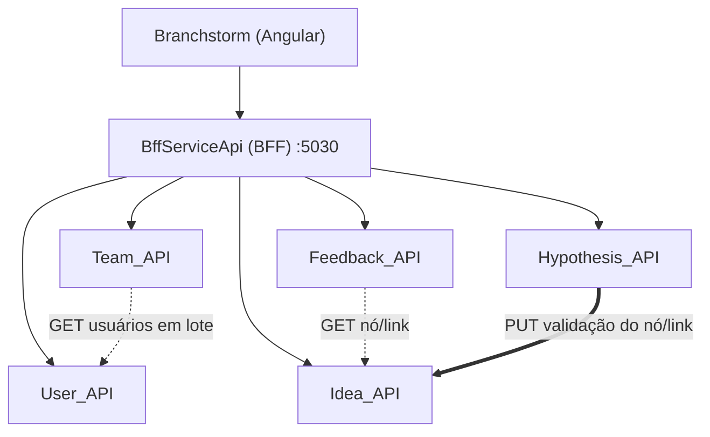

# BffServiceApi — Backend for Frontend do Branchstorm

Camada de back-end feita **para o Angular**. Em vez de o front chamar 4 ou 5 serviços para montar uma tela, ele faz **uma chamada por tela** e recebe o dado já no formato de exibição: árvore aninhada, nomes dos autores, contadores de hipóteses e feedback, caminho selecionado e quais botões podem aparecer.

Segue o mesmo template dos outros serviços (.NET 10, Controller → Service → ApiService/Client, `DependencyInjectionContainers`, `*Util` para registrar dependências). **Não tem banco**: só conversa por HTTP/REST com os microsserviços.



> As rotas dos microsserviços são as mesmas do gateway (`api/user`, `api/idea`, ...). Então o BFF funciona tanto chamando os serviços direto (padrão) quanto atrás do gateway: basta apontar as 5 `BaseUrl` para `http://localhost:5010`.

## Como executar

```bash
# suba os 5 microsserviços (portas 5252, 5236, 5221, 5159, 5076) e depois:
cd BffServiceApi/BffServiceApi
dotnet run
# BFF em http://localhost:5030  ·  documentação em http://localhost:5030/scalar
```

Configuração (mesmas chaves do gateway, também por variável de ambiente):

| Chave | Dev | Variável de ambiente |
|---|---|---|
| `UserApi:BaseUrl` | `http://localhost:5252` | `UserApi__BaseUrl` |
| `TeamApi:BaseUrl` | `http://localhost:5236` | `TeamApi__BaseUrl` |
| `IdeaApi:BaseUrl` | `http://localhost:5221` | `IdeaApi__BaseUrl` |
| `HypothesisApi:BaseUrl` | `http://localhost:5159` | `HypothesisApi__BaseUrl` |
| `FeedbackApi:BaseUrl` | `http://localhost:5076` | `FeedbackApi__BaseUrl` |
| `Cors:AllowedOrigins` | `http://localhost:4200` | `Cors__AllowedOrigins__0` |
| `Upstream:TimeoutSeconds` | `15` | `Upstream__TimeoutSeconds` |

Docker / Render: `docker build -t branchstorm-bff .` dentro desta pasta. O container usa a variável `PORT` do Render (padrão 5030). Métricas Prometheus em `/metrics`, como no gateway: para coletá-las, acrescente `host.docker.internal:5030` em `prometheus.yml`.

## Endpoints

Todas as rotas ficam em `/bff/...`. Os enums saem padronizados em minúsculas (`open`, `selected`, `not_tested`, `validated`, `problem`...), mesmo que cada serviço grave de um jeito (`Open`, `NotTested`).

### Telas (leitura agregada)

| Método e rota | O que devolve | Serviços chamados |
|---|---|---|
| `GET /bff/ideas/{code}/tree?includeDiscarded=true&includeStats=true` | Árvore **aninhada** da ideia (aceita o código de qualquer nó, sobe até a raiz e marca `focusCode`), com autor, equipe, contadores de hipóteses e feedback por nó, `isOnSelectedPath`, `actions` e resumo (`byStatus`, `byType`, `selectedPath`, `finalCode`, `maxDepth`) | Ideias, Hipóteses (lote), Feedback (lote), Usuários (lote), Equipes |
| `GET /bff/links/{code}` | Painel do nó: dados, autor, equipe, *breadcrumb* raiz → nó, filhos diretos, histórico, hipóteses com status, feedbacks com nome do autor, média e distribuição das notas, ações | Ideias, Hipóteses, Feedback, Usuários, Equipes |
| `GET /bff/teams/{code}` | Equipe com membros já com nome/e-mail, ordenados por papel, e `countByRole` | Equipes, Usuários (lote) |
| `GET /bff/users?name=&email=&codes=` · `GET /bff/users/{code}` | Busca de pessoas para os seletores. `codes` aceita mais de 100 (o BFF divide em lotes) | Usuários |
| `GET /bff/export/{code}` | Exportação RF12 (detalhes abaixo) | Todos |
| `GET /bff/export/profiles` | Perfis de vocabulário (RF13) | — |
| `GET /bff/health` | Estado de cada microsserviço (`healthy`, `degraded`, `unhealthy`) | Todos |

### Comandos (devolvem a tela já atualizada)

| Método e rota | Corpo | Resposta |
|---|---|---|
| `POST /bff/ideas` | `{ title, description?, autorCode?, teamCode? }` | `201` árvore |
| `POST /bff/links/{code}/children` | `{ title, reason, description?, type?, autorCode?, teamCode? }`: `type` é inferido (filho de problema vira `solution`, os demais `version`) e `teamCode` herda do pai | `201` árvore com foco no novo nó |
| `PUT /bff/links/{code}/select` | `{ reason? }`: os irmãos viram descartados | `200` árvore |
| `PUT /bff/links/{code}/validation` | `{ validation: not_tested\|validated\|refuted, reason? }` | `200` painel do nó |
| `POST /bff/links/{code}/hypotheses` | `{ description, successCriteria }` | `201` painel do nó |
| `PUT /bff/hypotheses/{code}/result` | `{ result: validated\|refuted }`: o serviço de Hipóteses atualiza a validação do nó (RF09) | `200` painel do nó |
| `POST /bff/links/{code}/feedbacks` | `{ autorCode, text, rating: 1..5 }`: **409** se o nó não estiver `open` | `201` painel do nó |
| `POST /bff/users` | `{ name, email }` | `201` usuário |
| `POST /bff/teams` | `{ name, description?, members: [{ userCode, role }] }` | `201` equipe |
| `PUT /bff/teams/{code}/members` | `{ members: [...] }`: substitui todos | `200` equipe |
| `POST /bff/teams/{code}/members` | `{ userCode, role }`: adiciona ou troca o papel | `200` equipe |
| `DELETE /bff/teams/{code}/members/{userCode}` | — (409 se a equipe ficar sem Owner/Admin) | `200` equipe |

`role` aceita `Admin`, `Owner`, `Collaborator` e `Evaluator` sem diferenciar maiúsculas. Antes de gravar, o BFF confere se os usuários informados existem (`400` se não existirem). Se o serviço de Usuários estiver fora do ar, essa checagem é pulada e a gravação segue.

### Exportação (RF12)

`GET /bff/export/{code}?scope=full&format=json&includeDiscarded=true&includeHistory=false&includeHypotheses=true&includeFeedback=true&profile=software&download=false`

- **scope**: `full` (árvore inteira), `selected` (só o caminho selecionado) ou `subtree` (o nó e seus descendentes, com os ancestrais em `context`).
- **format**: `json` (dados agregados para o front gerar o que quiser), `markdown`, `csv` (UTF-8 com BOM, abre direto no Excel) ou `mermaid`.
- **profile**: `software`, `tickets`, `decisions`, `research`, `teaching` ou `process`. Só troca os rótulos (Problema → Ticket, Hipótese → Verificação…).
- Com `includeFeedback=false`, a seção de feedback do Markdown sai como `(preencher)`, como no README do projeto.
- Exportar **nunca altera dados**.

## Comportamentos do BFF

- **Lotes de 100**: Usuários, Hipóteses e Feedback limitam as consultas em lote a 100 códigos. O BFF divide os códigos em blocos e faz as chamadas em paralelo, então uma árvore com 300 nós funciona.
- **Degradação elegante**: se um dado complementar falhar (nomes, notas, hipóteses, equipe), a tela continua vindo e o problema aparece em `warnings[]`, com o campo vazio ou `null`. Só falha a requisição inteira quando o dado principal (Ideias) não responde.
- **Erros padronizados (ProblemDetails)**: `{ status, title, detail, service?, upstreamStatus?, correlationId }`. Os microsserviços lançam `ArgumentException` (que chega como 500) para erro de entrada, e o BFF devolve isso como **400** com a mensagem original. Serviço fora do ar vira 503, demora vira 504 e falha interna vira 502.
- **X-Correlation-Id**: o BFF lê o cabeçalho (ou gera um), devolve na resposta e repassa para todos os microsserviços chamados, o que permite seguir uma ação pelos logs (README 7.1).
- **CORS** liberado só para as origens de `Cors:AllowedOrigins`.

## Estrutura

```
BffServiceApi/
├── BffApi.slnx
├── Dockerfile
├── BffServiceApi/                     # Web API
│   ├── Program.cs                     # CORS, ProblemDetails, OpenAPI/Scalar, OpenTelemetry
│   ├── Containers/DependencyInjectionContainers.cs
│   ├── Controllers/                   # Ideas, Links (+Hypotheses), Teams, Users, Export, Health
│   ├── Middlewares/BffExceptionHandler.cs   # erros → ProblemDetails + X-Correlation-Id
│   └── BffServiceApi.http             # requisições prontas para testar
└── BffServiceApiClassLibrary/
    ├── Clients/                       # um cliente HTTP por microsserviço (contratos espelham os DTOs reais)
    ├── Common/                        # UpstreamClient (tratamento de erro), lotes, normalização de enums
    ├── Services/                      # orquestração por tela: Ideas, Teams, Export, Health
    └── Views/                         # view models entregues ao Angular
```

## Limitações dos microsserviços (o BFF não contorna)

- **Marcar solução final (RF05)**: o serviço de Ideias não tem endpoint para o status `final`. O BFF já entende e exibe `final` (caminho, Mermaid, `finalCode`), mas não consegue gravá-lo. Quando o endpoint existir, falta só um `PUT /bff/links/{code}/final`.
- **Listar ideias por equipe ou autor**: não existe consulta para isso em Ideias, então não há tela de "minhas ideias" no BFF.
