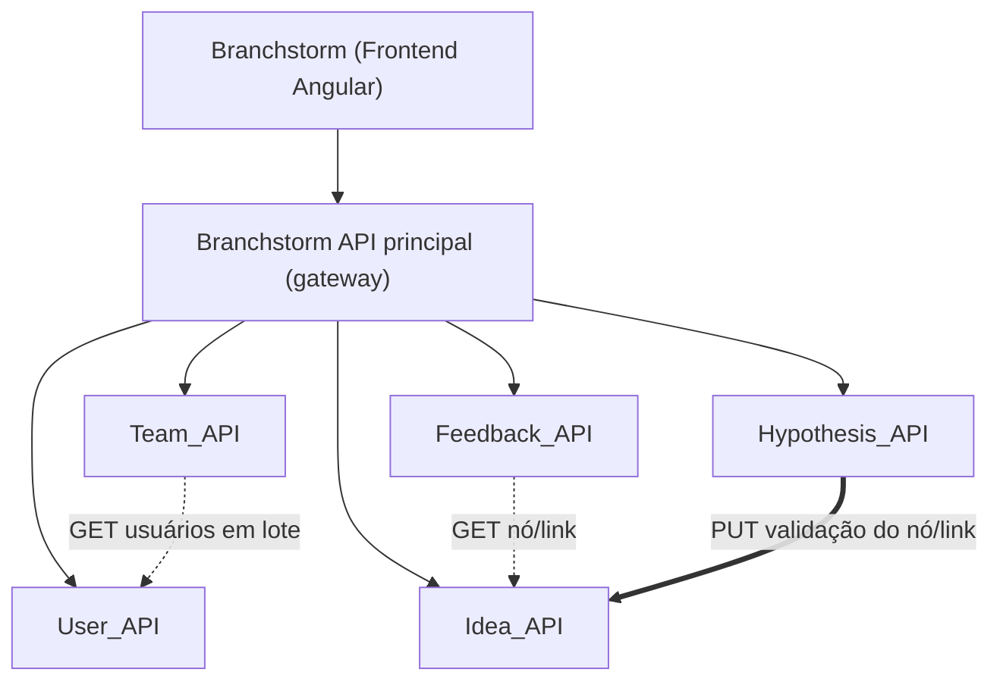
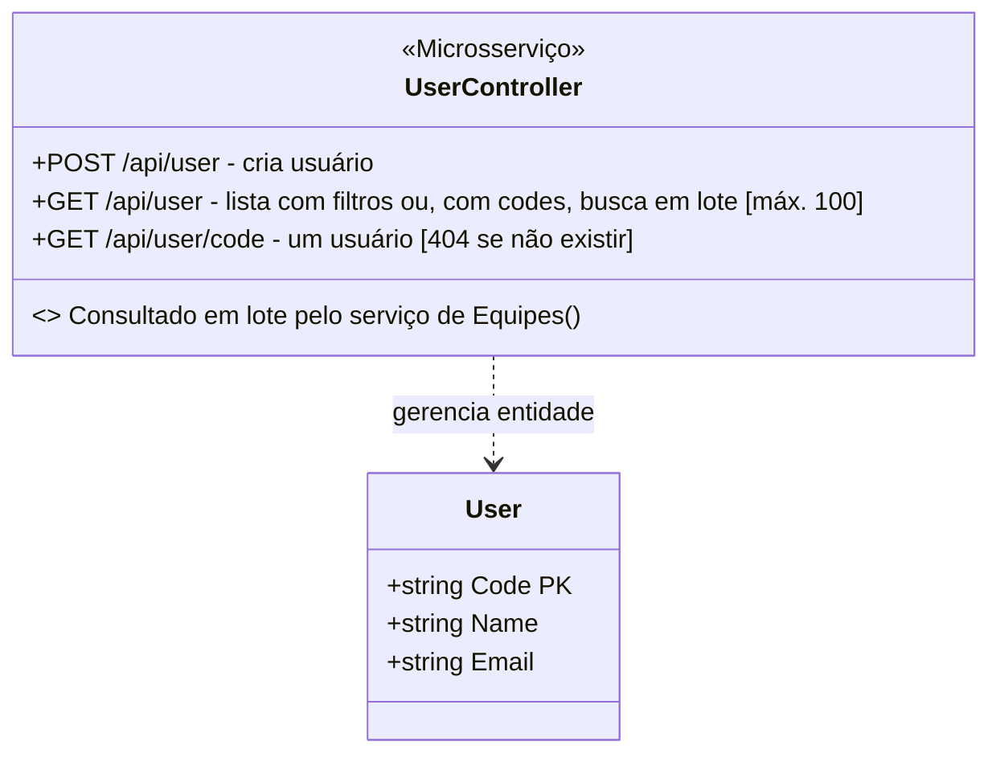
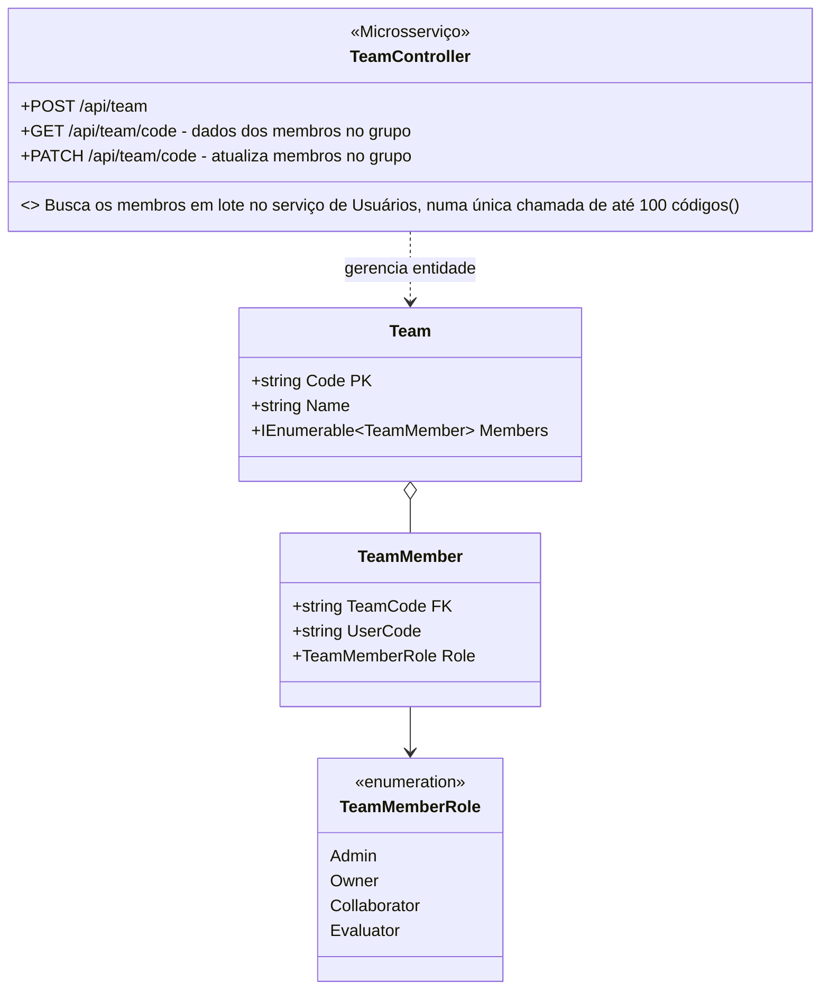
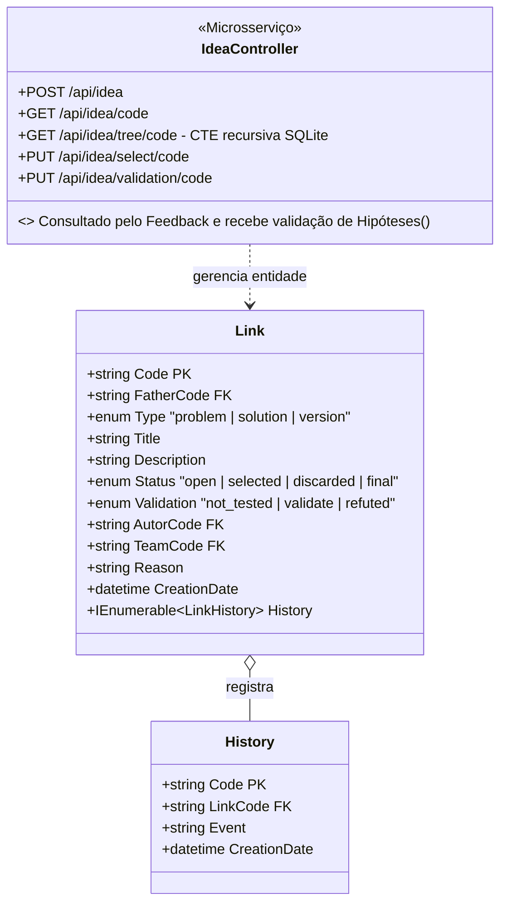
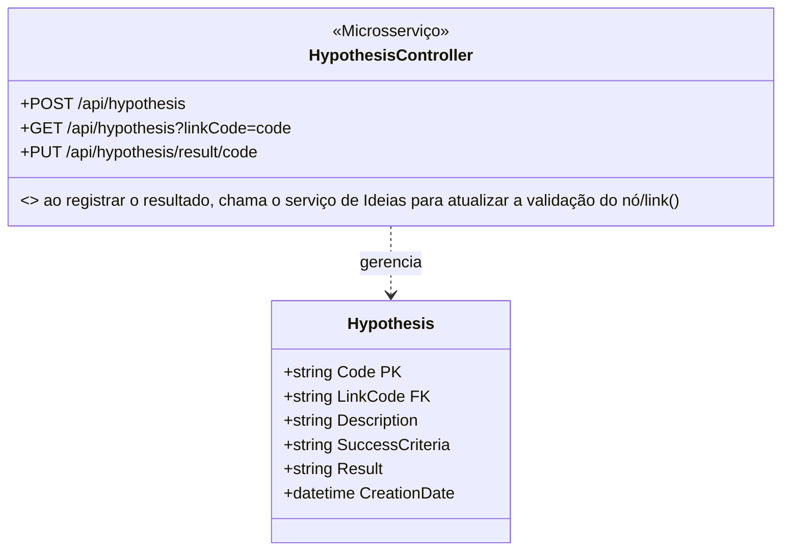
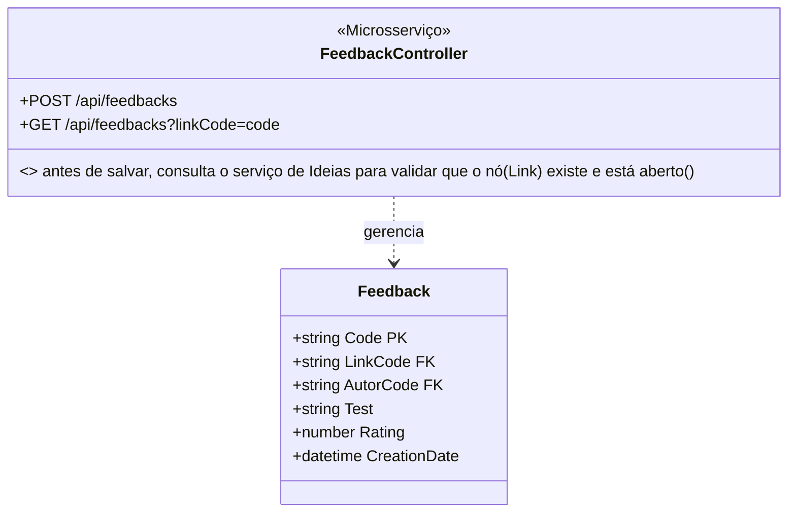
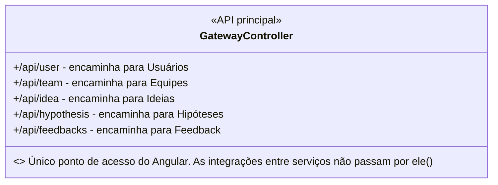
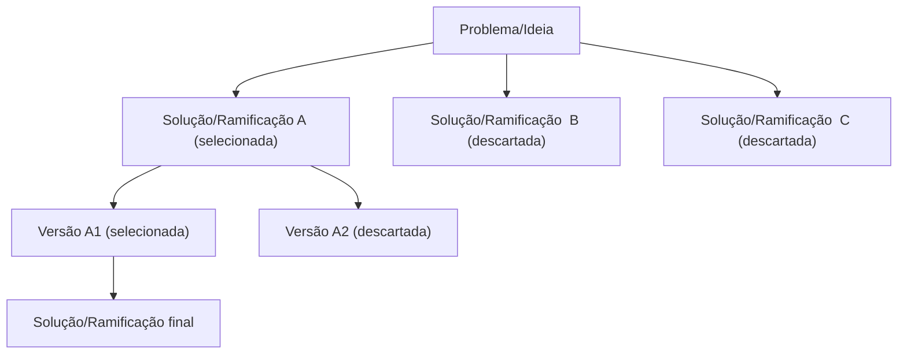

O nome junta *branch* (ramo, como no Git) com *brainstorm* (avalanche de ideias): um brainstorm que se ramifica. Plataforma colaborativa para evoluir e validar ideias. Cada problema vira a raiz de uma árvore: pessoas propõem soluções, comentam, testam hipóteses e a equipe vai selecionando versões até chegar a uma solução final, com todo o caminho registrado.

A ideia deste projeto foi justamente pensada para ajudar em uma dor dos estudantes em mapear ideias para possíveis projetos e/ou temas de inovação na área em engenharia de software (podendo abranger ou ser usado por outras áreas de conhecimento). 

Com isso, este é o projeto final da disciplina de Arquitetura de Software (Sistemas Distribuídos - microsserviços) em Engenharia de Software dos estudantes do Centro Universitário SATC. Orientado pelo professor: Eduardo Cizeski Meneghel.

- Domínio: [www.branchstorm.tech](https://www.branchstorm.tech/)
- Aplicação publicada no Render: `<link do Render>`
- Equipe: `Pedro Pavei`, `Matheus Cechinel`, `Thales Vaz`

---
## 1 Requisitos

### 1.1 Propósito do sistema

Permitir que pessoas e equipes cadastrem problemas e/ou ideias, desenvolvam soluções em forma de árvore (com versões e ramos alternativos para discussão ou reflexão), recebam feedback, discutam e/ou testem hipóteses, mantendo o histórico de por que cada caminho foi escolhido ou descartado. A inspiração é o Git: cada mudança é registrada. Ideal para protótipos e para anotações de ideias para futuros projetos e/ou trabalhos. 

### 1.2 Usuários

| Usuário | O que faz |
|---|---|
| Autor | Cria o problema/ideia raiz e propõe soluções e versões |
| Colaborador | Membro de uma equipe que propõe soluções, cria hipóteses e comenta |
| Avaliador | Comenta e dá nota nas ideias; pode ser convidado para uma equipe |

### 1.3 Requisitos funcionais

| Código | Requisito                                                                                            |
| ------ | ---------------------------------------------------------------------------------------------------- |
| RF01   | Cadastrar, consultar e listar usuários                                                               |
| RF02   | Criar equipes e adicionar/remover membros com um papel (administrador, dono, colaborador, avaliador) |
| RF03   | Cadastrar um problema/ideia raiz                                                                     |
| RF04   | Propor soluções e novas versões como filhos de um nó (link) da árvore, informando o motivo           |
| RF05   | Selecionar um nó (os irmãos viram descartados) e marcar um nó como solução final                     |
| RF06   | Consultar a árvore completa de uma ideia, incluindo nós descartados                                  |
| RF07   | Cadastrar hipóteses em um nó (link), com critério de sucesso                                         |
| RF08   | Registrar o resultado de uma hipótese (validada ou refutada)                                         |
| RF09   | Atualizar automaticamente a validação do nó a partir do resultado da hipótese                        |
| RF10   | Comentar e dar nota em um nó (link), apenas se ele estiver aberto a feedback                         |
| RF11   | Listar os feedbacks de um nó (link)                                                                  |
|        |                                                                                                      |

### 1.4 Regras de negócio principais

- Nós (links) descartados nunca são apagados, só mudam de status.
- Apenas um filho por nível pode estar selecionado.
- Feedback só é aceito em nós com status `aberto`.

---

## 2 Descritivo técnico

### 2.1 Visão geral

- Back-end com arquitetura de microsserviços, cada microsserviço segue o template visto em sala: **.NET, SQLite e REST**. 
- Frontend em Angular.
- API principal (gateway): ponto de entrada único do back-end. O Angular só fala com ela, e ela chama os microsserviços.

Cada serviço tem seu próprio banco e só conversa com os outros por HTTP no padrão REST.

*Evolução prevista: migrar de um SQLite por serviço para um PostgreSQL, com um banco e um usuário por serviço.*



As setas sólidas finas saem do gateway, que atende o Angular. As linhas tracejadas são buscas de dados entre serviços; a linha grossa é a alteração de dados entre serviços.

### 2.2 Microsserviços

| Serviço       | Função                                                          |
| ------------- | --------------------------------------------------------------- |
| **Usuários**  | Cadastro e consulta dos usuários                                |
| **Equipes**   | Equipes, membros e papéis                                       |
| **Ideias**    | Árvore de nós (problema, soluções, versões), status e histórico |
| **Hipóteses** | Hipóteses por nó, critério de sucesso, experimento e resultado  |
| **Feedback**  | Comentários e notas por nó                                      |
|               |                                                                 |

#### 2.2.1 Usuários


#### 2.2.2 Equipes



**Papéis dos membros:**
- `Admin`: possui todas as permissões da equipe, podendo gerenciá-la integralmente.
- `Owner`: proprietário da equipe, responsável por sua criação e administração.
- `Collaborator`: pode contribuir com soluções e hipóteses.
- `Evaluator`: pode comentar e avaliar ideias.


#### 2.2.3 Ideias



#### 2.2.4 Hipóteses



#### 2.2.5 Feedback




#### 2.2.6 API principal (gateway)



### 2.3 Integrações entre microsserviços

As três integrações acontecem diretamente entre os microsserviços, sem passar pela API principal (gateway). O gateway só atende o Angular.

| #   | Tipo               | Origem → Destino   | O que acontece                                                                                                                |
| --- | ------------------ | ------------------ | ----------------------------------------------------------------------------------------------------------------------------- |
| 1   | Busca de dados     | Equipes → Usuários | Ao exibir uma equipe, envia numa única chamada os códigos de todos os membros e recebe os dados deles (`GET /api/user?codes=...`, máx. 100)                                                  |
| 2   | Busca de dados     | Feedback → Ideias  | Ao cadastrar um feedback, valida se o nó/link existe e está aberto (`GET /api/idea/{code}`)                                   |
| 3   | Alteração de dados | Hipóteses → Ideias | Ao registrar o resultado de uma hipótese, atualiza a validação do nó e grava no histórico (`PUT /api/idea/validation/{code}`) |

A integração 3 pode evoluir para comunicação assíncrona: em vez de chamar Ideias diretamente, Hipóteses publica o evento `HypothesisResultRegistered` e Ideias o consome para atualizar a validação do nó/link e o histórico (detalhes em 7.1).

#### 2.3.1 Ideia de UI




## 3 Arquitetura
### 3.1 Persistência de dados: Dapper

Escolhemos o **Dapper** para realizar o acesso aos bancos de dados, permitindo escrever consultas SQL diretamente e mapear os resultados para objetos.

Cada microserviço terá seu próprio banco SQLite, com acesso feito por Repositories e pela interface `IDatabaseConnection`.

Essa estrutura facilita uma possível troca para PostgreSQL no futuro.

## 4 Trabalhos relacionados e diferencial

Já existem ferramentas e projetos que cobrem partes do Branchstorm:

- **Gestão de ideias corporativa** (por exemplo [HYPE](https://www.hypeinnovation.com/product/hype-go) e Ideanote): captura de ideias, votação, comentários e avaliação por critérios, sem versionamento de ideias.
- **Git para ideias**: projetos como [OpenIdeate](https://github.com/thanethomson/openideate) (pool de ideias com votos e forks) e [ideaBin](https://github.com/deepthought42/ideaBin) (um repositório Git por ideia), além do projeto de tese [Versionize](https://gist.github.com/runemadsen/941519), que usa Git para iterar ideias.
- **Árvores de discussão**: o [Kialo](https://en.wikipedia.org/wiki/Kialo) organiza debates em árvore, com a tese na raiz e argumentos a favor e contra nos ramos, mas é voltado a debate, não à evolução de soluções.

**Diferencial do Branchstorm:** combinar numa só plataforma a árvore problema → soluções → versões, com seleção e descarte registrados, e hipóteses com resultado que atualizam o estado dos nós. Pelo que pesquisamos, essa combinação não aparece nas ferramentas acima.

---

## 5 Tecnologias

- .NET (template de microsserviço da disciplina)
- Angular (frontend para o usuário)
- SQLite (um banco por serviço)
- Dapper (acesso a dados, com Repositories e `IDatabaseConnection`)
- Padrão REST sobre HTTP
- Servidor container Render

## 6 Como executar

```bash
# Serviço de Usuários
cd UserServiceApi
dotnet run
# API em https://localhost:7153 (confira a porta em Properties/launchSettings.json)
```

Os demais serviços serão adicionados aqui conforme ficarem prontos.

## 7 Extras e evolução futura


### 7.1 Extras previstos

- Integração com IA: 
	- sugestão de problemas/ideias aleatórios para discussão em grupo 
	- resumir os feedbacks de um nó (*link*) e sugerir hipóteses a partir da descrição.
- Comunicação assíncrona na integração Hipóteses → Ideias (mensageria):
	- em vez de chamar Ideias diretamente, Hipóteses publica o evento `HypothesisResultRegistered` ao registrar o resultado
	- Ideias consome o evento e atualiza a validação do nó/link e o histórico, mesmo que estivesse fora do ar no momento do registro
- Observabilidade: logs estruturados e health checks em todos os serviços (provavelmente Swarmpit)
	- acompanhar o evento da hipótese (publicado e consumido) nos logs, com um identificador de correlação

### 7.2 Ideias/Recursos de evolução

- **Troca de perspectivas (brainstorm aleatório):** a plataforma sorteia pares de equipes. A equipe A lança um problema e a equipe B propõe as soluções; depois os papéis se invertem. Seria um novo serviço, **Desafios**, que cria o nó (Link) raiz na equipe A e designa a equipe B para responder, reaproveitando os serviços de Ideias e Equipes.
- **Batalha de equipes:** várias equipes recebem o mesmo problema e cada uma desenvolve a própria árvore de soluções. No fim, os caminhos são comparados (hipóteses validadas, feedback recebido, profundidade da árvore).
- **Fork de ideias** entre equipes e votação nos nós.
- **Ranking de equipes** e modo relâmpago, com tempo limitado para propor soluções.
- **Login simplificado** para uso ágil com grandes grupos (com Google ou outro)
- **Salas de discussão simplificadas** (estilo Kahoot)
